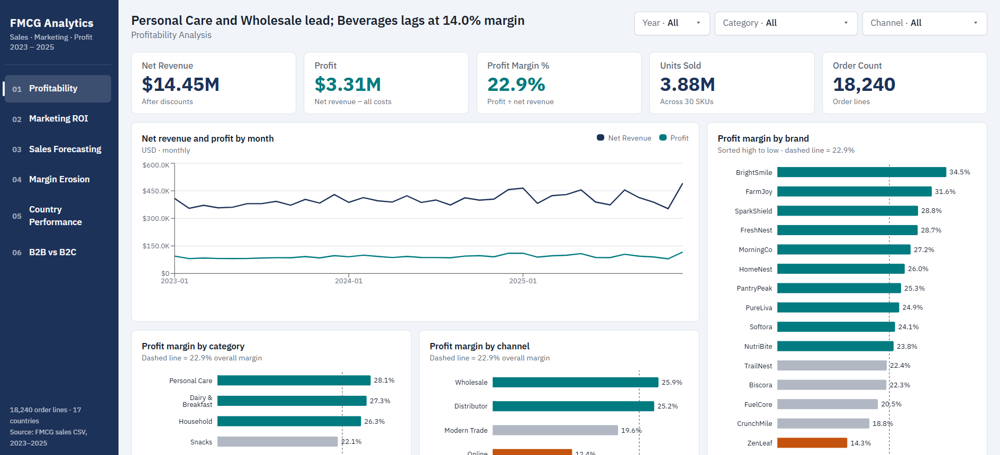
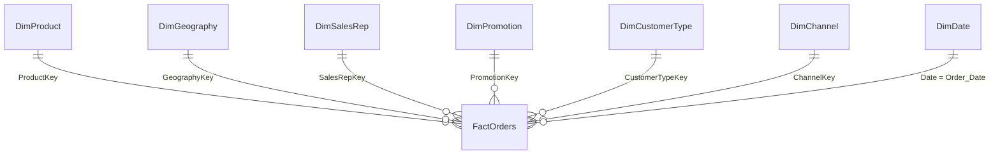

# FMCG Sales, Marketing & Profitability Analytics

A six-page Power BI dashboard covering three years of FMCG sales data: 18,240 order lines across 17 countries, 30 SKUs and 36 sales reps, from January 2023 to December 2025. Each page is one case study answering one business question, from where profit comes from to how B2B and B2C customers differ.



## The business problem

An FMCG business sells five product categories through four channels, with seven types of promotion. Revenue is growing, but leadership can't see clearly:

- which products, channels and markets actually make money
- whether marketing and promotions pay for themselves
- whether discounting is quietly eroding margin
- where revenue is heading next

This project turns the raw order data into a validated model and a dashboard that answers those questions. The full problem statement, objectives and requirements (BR-01 to BR-15) are in the [Business Requirements Document](docs/FMCG_Analytics_BRD.pdf).

## Headline numbers

| Net revenue | Profit | Profit margin | Marketing ROI | Order lines |
|---|---|---|---|---|
| **$14.45M** | **$3.31M** | **22.9%** | **2.12** | **18,240** |

Every figure was validated against the source CSV with DAX queries before the report pages were built.

## Key findings

1. **Beverages is the margin problem, and the cause is cost of goods.** It earns 14.0% margin against 28.1% for Personal Care. COGS takes 56.7% of Beverages gross sales vs 46.7% for Personal Care, while discount depth is about 15.4% in every category.
2. **Orders with no promotion are the most profitable.** No Promo returns 25.6% margin and $3.17 of profit per $1 of marketing. Festival Campaign is weakest on both (18.5%, $1.23).
3. **Deeper discounts do not erode margin.** Margin is lowest at 0–5% discount (18.3%) and highest at 10–20% (23.3%), the band that carries 62% of revenue.
4. **Margin is stable over time.** It stayed between 22.3% and 23.7% in all 12 quarters.
5. **Revenue grows about 4.5% a year, with a December peak** every year: $4.59M (2023), $4.84M (2024), $5.02M (2025).
6. **Online is the weakest channel:** 12.4% margin vs 25.9% for Wholesale.
7. **Three markets sit below 20% margin:** UAE, New Zealand and Australia, which is the 5th-largest market.
8. **B2B carries the business:** 75.5% of revenue at 24.5% margin vs 18.0% for B2C, ahead in every category despite deeper discounts.

The detail behind each finding is in [`insights/`](insights/README.md).

## The dashboard

| # | Page | Question it answers |
|---|---|---|
| 1 | Profitability Analysis | Which categories, brands and channels make the margin? |
| 2 | Marketing ROI | Which promotions pay back their marketing spend? |
| 3 | Sales Forecasting | Where is revenue heading over the next six months? |
| 4 | Margin Erosion Analysis | Does discounting or time erode margin? |
| 5 | Country Performance | Which markets lead and which lag? |
| 6 | B2B vs B2C Analysis | How do the two customer types differ? |

Every page shares a sidebar for navigation, synced Year / Category / Channel slicers, and one colour rule: **teal** at or above the 22.9% overall margin, **grey** below it, **orange** for laggards. Page-by-page detail is in [`report/`](report/README.md), and screenshots are in [`report/screenshots/`](report/screenshots/README.md).

## Approach

The project followed a 10-stage data analytics life cycle, including a dedicated forecasting stage ([life cycle document](docs/FMCG_Analytics_Lifecycle.pdf)). The requirements were broken into 15 user stories across seven epics ([user stories](docs/FMCG_Analytics_UserStories.pdf)).

| Stage | What was done |
|---|---|
| Load and profile | 18,240 rows, 27 columns, no errors, unique order IDs |
| Clean and check | Row formulas verified: Gross = Units × Price, Net = Gross × (1 − Discount), Profit = Net − costs |
| Model | Star schema: one fact table, seven dimensions, a dedicated measures table |
| Measure | 14 DAX measures in Core, Marketing, Baseline and Formatting folders |
| Validate | 12 reconciliation checks against the source, all matching |
| Forecast | Power BI exponential smoothing, tested on a Jul–Dec 2025 holdout |
| Report | Six pages with takeaway titles, rule-based colours and sidebar navigation |

### Data model



Tables, measures and validation results are documented in [`model/`](model/README.md).

### A problem worth knowing about

The CSV writes decimals with a period. On a machine set to comma decimals, Power BI silently read $12.74 as $1,274, inflating every total about 100x with no error message. The standard fixes (culture-aware type conversion) were not reliable, so the staging query uses a small parser that rebuilds each number from its digits and cannot be affected by regional settings. The code is in [`model/Staging_Orders.pq`](model/Staging_Orders.pq).

## Repository structure

```
├── data/        Source CSV
├── docs/        BRD, life cycle, user stories, build guide
├── insights/    Findings for all six case studies
├── model/       Model documentation, measures, Power Query, .bim definition
├── report/      FMCG_Analytics.pbix and page screenshots
└── LICENSE
```

## How to open it

1. Install [Power BI Desktop](https://powerbi.microsoft.com/desktop/) (free, Windows).
2. Download [`report/FMCG_Analytics.pbix`](report/FMCG_Analytics.pbix) and open it. The data is embedded, so no connection is needed.
3. Use the sidebar to move between pages. In Desktop, hold **Ctrl** and click.

To rebuild from scratch, follow the [build guide](docs/FMCG_PowerBI_Build_Guide_v2.pdf).

## Tools

Power BI Desktop · Power Query (M) · DAX · Power BI Modeling MCP server, used with Claude to build and validate the model

## Notes

The dataset is synthetic. The findings demonstrate the analysis method; they are not real market facts.

## Author

**Ntiyiso Ndhlovu**, Business Analyst · [GitHub](https://github.com/ntiyisondhlovu)
