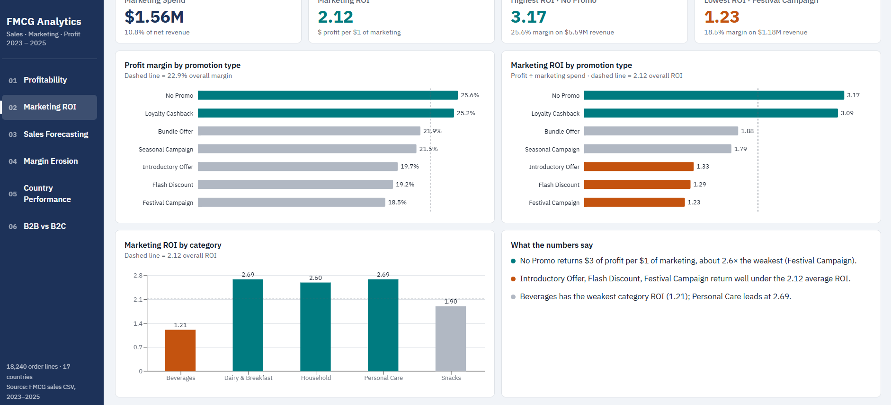
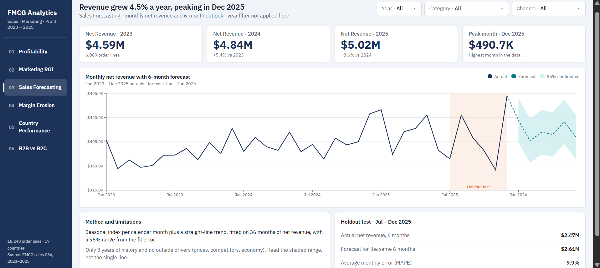
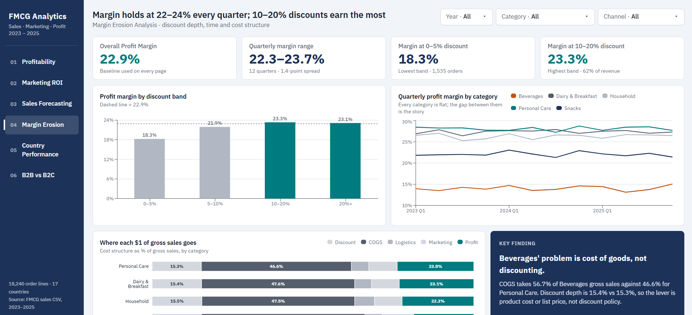
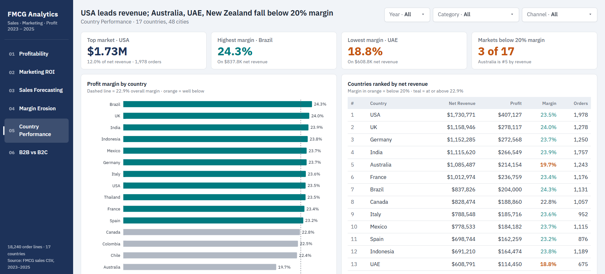
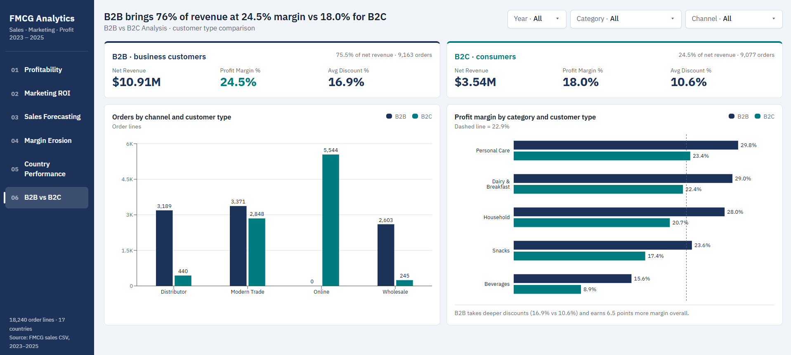
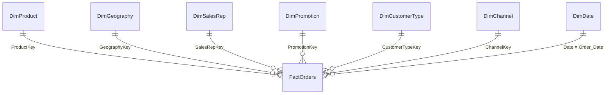

# FMCG Sales, Marketing & Profitability Analytics

**A six-page Power BI dashboard that shows where an FMCG business makes and loses money.**

Three years of sales data (18,240 order lines, January 2023 – December 2025) across 17 countries, 30 SKUs, 5 product categories, 4 sales channels and 7 promotion types. Each page is one case study answering one business question.

| Net revenue | Profit | Profit margin | Marketing ROI | Order lines |
|:---:|:---:|:---:|:---:|:---:|
| **$14.45M** | **$3.31M** | **22.9%** | **2.12** | **18,240** |

---

## Dashboard preview

| | |
|:---:|:---:|
| **1 · Profitability Analysis** | **2 · Marketing ROI** |
|  |  |
| **3 · Sales Forecasting** | **4 · Margin Erosion Analysis** |
|  |  |
| **5 · Country Performance** | **6 · B2B vs B2C Analysis** |
|  |  |

---

## The business problem

Revenue is growing, but the business can't see clearly:

- which products, channels and markets actually make money
- whether marketing and promotions pay for themselves
- whether discounting is quietly eroding margin
- where revenue is heading next

This project turns the raw order data into a validated data model and a dashboard that answers those questions. The full problem statement, objectives and requirements (BR-01 to BR-15) are in the [Business Requirements Document](docs/FMCG_Analytics_BRD.pdf).

---

## Six case studies

| # | Page | Business question | Answer in one line |
|---|---|---|---|
| 1 | Profitability Analysis | Which categories, brands and channels make the margin? | Personal Care (28.1%) and Wholesale (25.9%) lead; Beverages (14.0%) and Online (12.4%) lag. |
| 2 | Marketing ROI | Which promotions pay back their marketing spend? | Orders with no promotion return the most: 25.6% margin and $3.17 profit per $1 of marketing. |
| 3 | Sales Forecasting | Where is revenue heading? | Revenue grows about 4.5% a year, with a December peak every year. |
| 4 | Margin Erosion Analysis | Does discounting or time erode margin? | No. Margin holds at 22–24% every quarter and is highest at 10–20% discount. |
| 5 | Country Performance | Which markets lead and which lag? | The USA leads revenue; UAE, New Zealand and Australia fall below 20% margin. |
| 6 | B2B vs B2C Analysis | How do the two customer types differ? | B2B brings 75.5% of revenue at 24.5% margin vs 18.0% for B2C. |

---

## Key findings

**1. Beverages is the margin problem, and the cause is cost of goods.**
Beverages is the largest category by revenue ($3.74M) but earns the lowest margin, 14.0% against 28.1% for Personal Care. Cost of goods takes 56.7% of Beverages gross sales vs 46.7% for Personal Care, while discount depth is about 15.4% in every category. Discounting doesn't explain the gap; product cost does.

**2. Orders with no promotion are the most profitable.**
No Promo returns a 25.6% margin and $3.17 of profit per $1 of marketing. Loyalty Cashback comes close (25.2%, $3.09). Festival Campaign is the weakest on both (18.5%, $1.23).

**3. Deeper discounts do not erode margin.**
Margin is lowest at 0–5% discount (18.3%) and highest at 10–20% (23.3%), the band that carries 62% of revenue. This is a real, counter-intuitive result in the data.

**4. Margin is stable over time.**
Quarterly margin stayed between 22.3% and 23.7% across all 12 quarters. Every category is flat; the gap between categories is the story.

**5. Revenue grows steadily, peaking every December.**
$4.59M (2023) → $4.84M (2024, +5.4%) → $5.02M (2025, +3.6%). December was the top month in all three years.

**6. Online is the weakest channel.**
12.4% margin vs 25.9% for Wholesale. Every Online order is B2C.

**7. Three markets sit below 20% margin.**
UAE (18.8%), New Zealand (19.4%) and Australia (19.7%). Australia is the 5th-largest market, so its gap costs the most profit. The USA leads revenue at $1.73M.

**8. B2B carries the business.**
B2B brings three-quarters of revenue and earns 6–7 points more margin than B2C in every category, despite deeper average discounts (16.1% vs 9.7%).

Full tables behind every finding are in [`insights/`](insights/README.md).

---

## How it was built

The project followed a 10-stage data analytics life cycle, including a dedicated forecasting stage ([life cycle document](docs/FMCG_Analytics_Lifecycle.pdf)). Requirements were broken into 15 user stories across seven epics ([user stories](docs/FMCG_Analytics_UserStories.pdf)).

| Stage | What was done |
|---|---|
| Load and profile | 18,240 rows and 27 columns, 100% valid, unique order IDs |
| Clean and check | Row formulas verified on every row: Gross = Units × Price, Net = Gross × (1 − Discount), Profit = Net − costs |
| Model | Star schema: one fact table, seven dimensions, a dedicated measures table |
| Measure | 14 DAX measures in Core, Marketing, Baseline and Formatting folders |
| Validate | 12 reconciliation checks against the source data, all matching |
| Forecast | Power BI exponential smoothing, 6 months ahead, tested on a Jul–Dec 2025 holdout |
| Report | Six pages with takeaway titles, rule-based colours, synced slicers and sidebar navigation |

### Data model



| Table | Rows | | Table | Rows |
|---|---|---|---|---|
| FactOrders | 18,240 | | DimPromotion | 7 |
| DimProduct | 30 | | DimCustomerType | 2 |
| DimGeography | 48 | | DimChannel | 4 |
| DimSalesRep | 36 | | DimDate | 1,096 |

Tables, measures and validation results are documented in [`model/`](model/README.md), and every measure's DAX is in [`model/measures.md`](model/measures.md).

### Design choices

- **One colour rule across all pages.** Teal means at or above the 22.9% overall margin, grey means below it, and orange flags laggards (margin under 15%). The colours come from DAX measures, so they update with every slicer.
- **Takeaway titles.** Each page title states the finding, not just the topic.
- **Revenue-weighted margin.** Profit Margin % is total profit ÷ total revenue, not an average of row-level margins, so large orders count for what they are worth.
- **Sidebar navigation** on every page, with the current page highlighted, so the report reads as one application.

### A problem worth knowing about

The CSV writes decimals with a period. On a computer set to comma decimals, Power BI silently read $12.74 as $1,274, inflating every total about 100x with no error message. The standard fix (culture-aware type conversion) was not reliable, so the staging query uses a small parser that rebuilds each number from its digits and cannot be affected by regional settings. The code is in [`model/Staging_Orders.pq`](model/Staging_Orders.pq).

---

## Repository structure

```
fmcg-sales-marketing-profitability-analytics/
├── data/          Source CSV (18,240 order lines)
├── docs/          BRD, data analytics life cycle, user stories, build guide
├── insights/      Findings for all six case studies
├── model/         Data model documentation, measures, Power Query, .bim definition
├── report/        FMCG_Analytics.pbix
│   └── screenshots/   One image per report page
├── LICENSE
└── README.md
```

---

## How to open it

1. Install [Power BI Desktop](https://powerbi.microsoft.com/desktop/) (free, Windows).
2. Download [`report/FMCG_Analytics.pbix`](report/FMCG_Analytics_v4.pbix) and open it. The data is embedded, so no connection is needed.
3. Use the sidebar to move between pages. In Power BI Desktop, hold **Ctrl** and click a button.


---

## Tools

| Tool | Used for |
|---|---|
| Power BI Desktop | Report and data model |
| Power Query (M) | Loading, cleaning and the locale-safe number parser |
| DAX | Measures, baselines and rule-based colours |
| Power BI Modeling | Building the star schema and validating every figure against the source |

---

## Note on the data

The dataset is synthetic. The findings demonstrate the analysis method; they are not real market facts.

## Author

**Ntiyiso Ndhlovu**, Business Analyst
[GitHub](https://github.com/ntiyisondhlovu)

## License

See [LICENSE](LICENSE).
