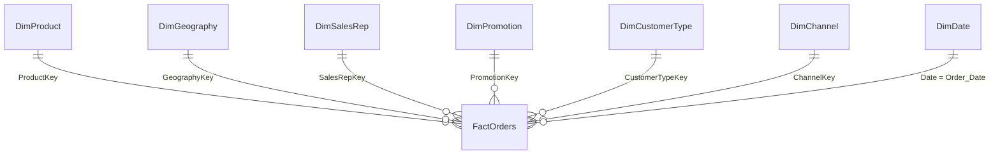

# Data model

The semantic model behind the FMCG Analytics dashboard: one staging query, a star schema of one fact table and seven dimensions, and a dedicated measures table. It was built and validated through the Power BI Modeling MCP server, and every total reconciles to the source CSV.

## Star schema



Every relationship is one-to-many, single direction (dimension filters fact), and active. There are no relationships between dimensions.

## Tables

| Table | Rows | Grain | Built from |
|---|---|---|---|
| **FactOrders** | 18,240 | One order line | Staging_Orders, joined to each dimension to pick up its key |
| **DimProduct** | 30 | One SKU | Distinct Product_Category, Brand, Product_Name, SKU |
| **DimGeography** | 48 | One city | Distinct Region, Country, City |
| **DimSalesRep** | 36 | One sales rep | Distinct Sales_Person |
| **DimPromotion** | 7 | One promotion type | Distinct Promotion_Type, including No Promo |
| **DimCustomerType** | 2 | B2B or B2C | Distinct Customer_Type |
| **DimChannel** | 4 | One channel | Distinct Sales_Channel |
| **DimDate** | 1,096 | One day | Generated calendar, 2023-01-01 to 2025-12-31 |
| **Staging_Orders** | 18,240 | One CSV row | The raw CSV, with numbers parsed safely. Hidden from report view. |
| **_Measures** | — | — | Holds all 14 measures; its one placeholder column is hidden |

Each dimension is built by taking the distinct values from Staging_Orders, sorting them, and adding an integer key starting at 1. FactOrders left-joins each dimension on its natural columns, keeps the key, then drops the text columns.

### FactOrders

| Column | Type | Notes |
|---|---|---|
| Order_ID | Text | Unique per row |
| Order_Date | Date | Hidden; links to DimDate[Date] |
| Units_Sold | Whole number | |
| Unit_Price_USD | Decimal | $1.45 to $12.74 |
| Discount_Pct | Decimal | **Whole percentage**: 12.5 means 12.5% |
| Gross_Sales_USD | Decimal | Units_Sold × Unit_Price_USD |
| Net_Revenue_USD | Decimal | Gross × (1 − Discount_Pct / 100) |
| COGS_USD | Decimal | |
| Logistics_Cost_USD | Decimal | |
| Marketing_Spend_USD | Decimal | |
| Profit_USD | Decimal | Net − COGS − Logistics − Marketing |
| Profit_Margin_Pct | Decimal | **Whole percentage**, row level |
| ProductKey, GeographyKey, SalesRepKey, PromotionKey, CustomerTypeKey, ChannelKey | Whole number | Hidden foreign keys |

### DimDate

| Column | Example | Notes |
|---|---|---|
| Date | 2025-12-31 | Key column; table is marked as the date table |
| Year | 2025 | |
| Quarter | Q4 | Sorted by QuarterNo |
| QuarterNo | 4 | Hidden sort column |
| Month | 12 | |
| Month_Name | Dec | Sorted by Month |
| YearMonth | 2025-12 | Sorted by YearMonthKey |
| YearMonthKey | 202512 | Hidden sort column |
| Month_Start | 2025-12-01 | X-axis for monthly trends and the forecast |

## Measures

All measures sit in `_Measures`, grouped into display folders. The full DAX, formats and plain-language meanings are in [`measures.md`](measures.md).

| Folder | Measures |
|---|---|
| **Core** | Net Revenue · Gross Sales · Profit · Profit Margin % · Units Sold · Order Count |
| **Marketing** | Marketing Spend · Marketing ROI · Avg Discount % |
| **Baseline** | Overall Profit Margin (22.9%) · Overall Marketing ROI (2.12) |
| **Formatting** | Margin Bar Colour · ROI Bar Colour · Margin Text Colour |

**Design notes**

- **Profit Margin % is weighted by revenue.** It is `DIVIDE([Profit], [Net Revenue])`, not an average of the row-level Profit_Margin_Pct column. Averaging row margins would give small orders the same weight as large ones.
- **Avg Discount % divides by 100,** because Discount_Pct is stored as whole percentages. Without it the card would read 1,294%.
- **Baselines ignore all filters** (`REMOVEFILTERS()`), so the dashed reference lines stay fixed at 22.9% and 2.12 whatever the slicers show.
- **The Formatting measures return hex colours** and are used through Format › Colors › fx › Field value. Teal (#0E7C86) means at or above the baseline, orange (#C2571A) flags laggards (margin under 15% or ROI under 1.5), and grey (#B4BCC8) is everything in between. The thresholds live in one place, so changing a rule updates every chart.

## Power Query: Staging_Orders

The source CSV writes decimals with a period (12.74). On a machine whose regional settings use a comma, Power BI's culture-based conversions failed in two ways during the build: untyped columns loaded as text (so SUM failed), and `Number.FromText(..., "en-US")` was ignored on refresh, reading 12.74 as **1274** and inflating every total about 100x with no error.

The fix is a small parser that never asks Power BI to interpret a decimal separator. It splits each value on the period and rebuilds the number from digits:

```powerquery
ParseDot = (v as nullable text) as nullable number =>
    let
        t        = if v = null then "" else Text.Trim(v),
        neg      = Text.StartsWith(t, "-"),
        body     = Text.Remove(t, {"-", "+"}),
        parts    = Text.Split(body, "."),
        intPart  = if parts{0} = "" then 0 else Number.From(parts{0}),
        fracText = if List.Count(parts) > 1 then parts{1} else "",
        fracPart = if fracText = "" then 0
                   else Number.From(fracText) / Number.Power(10, Text.Length(fracText)),
        result   = if t = "" then null else (if neg then -1 else 1) * (intPart + fracPart)
    in
        result
```

It is applied to all nine money and percent columns, each as its own typed `Table.AddColumn(..., type number)` step. The complete query is in [`Staging_Orders.pq`](Staging_Orders.pq).

> **Stale-cache warning:** after a table has loaded wrong numbers, refreshing it may keep serving the cached result even once the query is fixed. Deleting and recreating the table was the only reliable way to force a genuine reload.

## Validation

Checked with DAX queries against the source before any report page was built:

| Check | Result |
|---|---|
| Row counts | 30 / 48 / 36 / 7 / 2 / 4 / 1,096 / 18,240, as expected |
| Order_ID | 18,240 distinct, no duplicates |
| Blank foreign keys | 0 across all six keys |
| Totals | Net revenue $14,449,920 · Profit $3,308,965 · Margin 22.9% |
| Unit price range | $1.45 to $12.74 |
| Row formulas | Gross, Net and Profit formulas hold on all 18,240 rows |
| Relationships | Every dimension filters FactOrders; yearly order lines add to 18,240 (6,069 + 6,073 + 6,098) |
| Spot figures | B2B $10,912,271 at 24.5%; B2C $3,537,649 at 18.0%; Beverages 14.0%; Online 12.4% |

## Files in this folder

| File | Contents |
|---|---|
| [`measures.md`](measures.md) | Every measure with its DAX, format and meaning |
| [`model_reference.md`](model_reference.md) | Every table, column, data type, sort order and relationship |
| [`Staging_Orders.pq`](Staging_Orders.pq) | The full staging query, including the parser |
| [`FMCG_Analytics_Model.bim`](FMCG_Analytics_Model.bim) | Complete model definition. Opens in Tabular Editor and can redeploy the model. It contains the structure, not the data. |

The model itself lives in [`../report/FMCG_Analytics.pbix`](../report).

